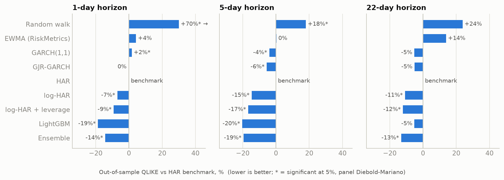
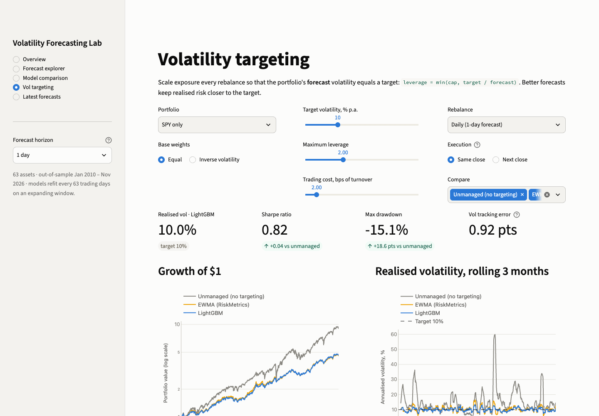
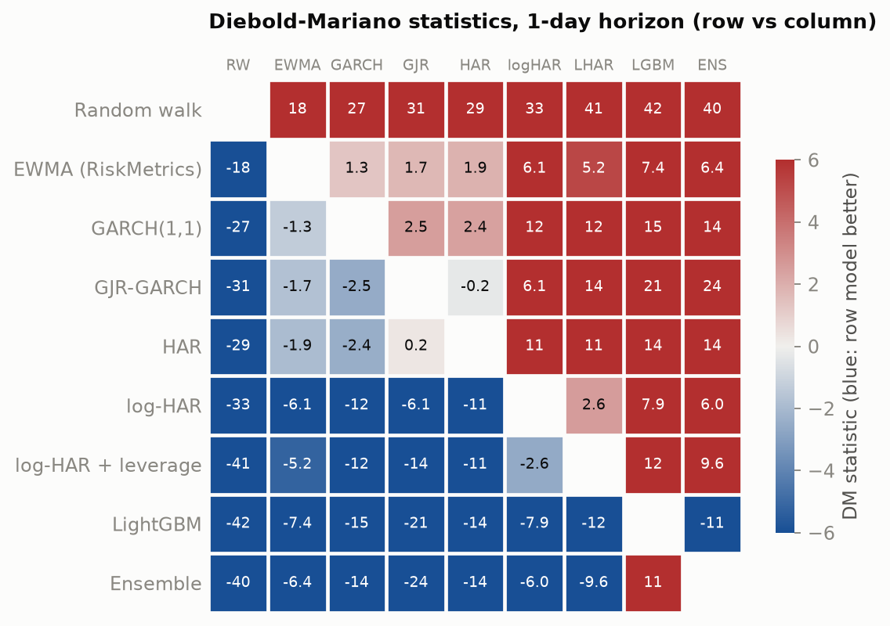
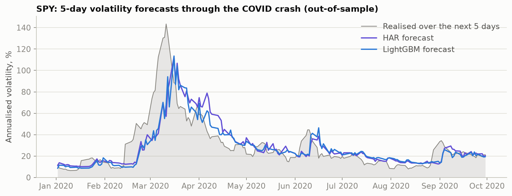
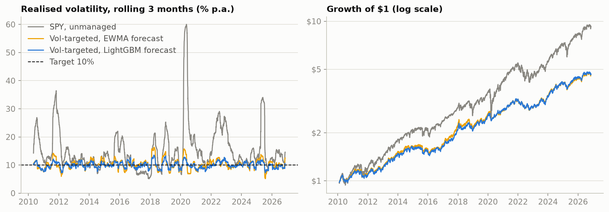

# Volatility Forecasting Lab

[](https://github.com/tomeelow/volatility-forecasting/actions/workflows/tests.yml)

[](LICENSE)

Walk-forward volatility forecasting on **63 assets** with GARCH, HAR-RV and gradient boosting —
evaluated with QLIKE and Diebold-Mariano tests, and put to work in a volatility-targeting backtest.

Prices are close to unpredictable. Volatility is not: it clusters, mean-reverts and reacts
asymmetrically to losses. This project measures *how much* of it can be forecast, by which model,
and what that is worth in a portfolio — with a test design in which no forecast ever sees the future.



**Headline results** (out-of-sample, Jan 2010 – Nov 2026, 267K forecasts per model and horizon):

- A pooled **LightGBM** model trained directly on the QLIKE loss cuts forecast loss by **19%** at the
  1-day horizon and **20%** at 5 days relative to the standard HAR benchmark, and is significantly
  better on 60 of 63 assets (per-asset Diebold-Mariano, 5% level) — and significantly worse on none.
- The edge **does not survive at the 1-month horizon**: there LightGBM is statistically indistinguishable
  from HAR, and a plain log-HAR with leverage terms (or a simple three-model ensemble) is the best choice.
- **Volatility targeting works as risk control, not as an alpha source.** Targeting 10% on SPY keeps
  realised volatility at 10.0% with a max drawdown of −15% instead of −34%, at a Sharpe ratio that is
  about the same (0.82 vs 0.78). Better forecasts track the target more tightly.

## Dashboard

An interactive Streamlit app to explore every forecast, re-run the model comparison on any
slice of assets and years, and play with the volatility-targeting parameters.

```bash
uv run volcast app
```



| View | What you can do |
|---|---|
| **Overview** | Leaderboard for the chosen horizon, with significance tests |
| **Forecast explorer** | Any asset, any models, crisis-period presets; forecast vs what was realised |
| **Model comparison** | Filter by asset class and years; Diebold-Mariano matrix; gains by class and by year; feature importance |
| **Vol targeting** | Pick a portfolio, target, leverage cap, costs, rebalance frequency, execution lag; compare forecast models |
| **Latest forecasts** | Current volatility forecast for every asset |

## Quick start

Requires [uv](https://docs.astral.sh/uv/) (Python 3.11+ is installed automatically).

```bash
git clone https://github.com/tomeelow/volatility-forecasting.git
cd volatility-forecasting
uv sync                 # install dependencies
uv run volcast all      # download data, build features, forecast, evaluate, backtest (~6 min)
uv run volcast app      # open the dashboard
uv run pytest           # 26 tests, including look-ahead checks
```

Individual steps: `volcast download | features | forecast | evaluate | backtest | figures`.
Data comes from Yahoo Finance and is cached in `data/`; pass `--force` to refresh it.
Results will differ slightly from the tables below as new data arrives.

## Results

### Forecast accuracy

QLIKE loss (lower is better), pooled over all assets and days. *vs HAR* is the relative change in loss.
*DM stat* is the panel Diebold-Mariano statistic against HAR (negative = better than HAR; |stat| > 1.96
is significant at 5%). *Assets* counts the assets on which the model is significantly better / worse
than HAR. *MCS p* is the model-confidence-set p-value: models above 0.10 cannot be distinguished from the best.

**1-day horizon**

| Model | QLIKE | vs HAR | DM stat | Assets better / worse | MCS p |
|---|---:|---:|---:|---:|---:|
| Random walk | 0.783 | +69.9% | +29.3 | 0 / 62 | 0.00 |
| EWMA (RiskMetrics) | 0.481 | +4.3% | +1.9 | 5 / 32 | 0.00 |
| GARCH(1,1) | 0.469 | +1.7% | +2.4 | 6 / 30 | 0.00 |
| GJR-GARCH | 0.460 | −0.2% | −0.2 | 7 / 19 | 0.00 |
| HAR | 0.461 | benchmark | – | – | 0.00 |
| log-HAR | 0.429 | −7.0% | −10.8 | 39 / 0 | 0.00 |
| log-HAR + leverage | 0.419 | −9.1% | −11.4 | 50 / 0 | 0.00 |
| **LightGBM** | 0.375 | −18.6% | −14.4 | 60 / 0 | 1.00 |
| Ensemble | 0.395 | −14.3% | −14.5 | 63 / 0 | 0.00 |

**5-day horizon**

| Model | QLIKE | vs HAR | DM stat | Assets better / worse | MCS p |
|---|---:|---:|---:|---:|---:|
| Random walk | 0.365 | +18.0% | +4.1 | 5 / 49 | 0.00 |
| EWMA (RiskMetrics) | 0.310 | +0.3% | +0.1 | 5 / 21 | 0.00 |
| GARCH(1,1) | 0.297 | −4.0% | −2.0 | 6 / 15 | 0.00 |
| GJR-GARCH | 0.292 | −5.6% | −3.0 | 7 / 8 | 0.00 |
| HAR | 0.309 | benchmark | – | – | 0.00 |
| log-HAR | 0.264 | −14.6% | −7.3 | 45 / 0 | 0.00 |
| log-HAR + leverage | 0.257 | −16.7% | −8.5 | 50 / 0 | 0.00 |
| **LightGBM** | 0.246 | −20.3% | −7.0 | 50 / 0 | 1.00 |
| Ensemble | 0.249 | −19.4% | −9.7 | 60 / 0 | 0.51 |

**22-day horizon**

| Model | QLIKE | vs HAR | DM stat | Assets better / worse | MCS p |
|---|---:|---:|---:|---:|---:|
| Random walk | 0.351 | +23.8% | +1.8 | 1 / 30 | 0.00 |
| EWMA (RiskMetrics) | 0.323 | +13.9% | +1.0 | 1 / 13 | 0.01 |
| GARCH(1,1) | 0.269 | −5.2% | −1.2 | 9 / 1 | 0.00 |
| GJR-GARCH | 0.269 | −5.1% | −1.4 | 7 / 2 | 0.00 |
| HAR | 0.284 | benchmark | – | – | 0.03 |
| log-HAR | 0.253 | −10.9% | −2.2 | 25 / 0 | 0.03 |
| log-HAR + leverage | 0.249 | −12.1% | −2.6 | 31 / 0 | 0.12 |
| LightGBM | 0.269 | −5.2% | −0.5 | 7 / 0 | 0.10 |
| **Ensemble** | 0.246 | −13.1% | −2.7 | 31 / 0 | 1.00 |

What the tables say:

1. **Volatility is forecastable.** Yesterday's variance (random walk) is a terrible forecast; any
   model that averages over several horizons does far better.
2. **Modelling logs helps** (log-HAR vs HAR: −7% at 1 day), and **leverage terms add a further
   2 points** — negative returns raise future volatility beyond what past volatility implies.
3. **GARCH roughly matches HAR** at 1 day and edges it at longer horizons, but never approaches the
   log-HAR models; it uses only close-to-close returns and ignores the intraday range.
4. **Boosting wins where there is enough independent data.** At 1 and 5 days it leads clearly; at
   22 days, where targets overlap heavily and the effective sample is ~20x smaller, it does not.
5. **The gains are broad, not one episode**: the dashboard's by-year and by-asset-class heatmaps
   show LightGBM ahead of HAR in every calendar year (by 11–28%) and in every asset class at the 1-day horizon.





### Volatility targeting

SPY, 10% volatility target, daily rebalancing with the 1-day forecast, leverage capped at 2x,
2 bps trading cost, cash and borrowing at the T-bill rate. *Tracking error* is the average absolute gap
between rolling 3-month realised volatility and the target, in volatility points.

| Strategy | Ann. return | Ann. vol | Sharpe | Max drawdown | Tracking error | Turnover / yr |
|---|---:|---:|---:|---:|---:|---:|
| Unmanaged (no targeting) | 14.2% | 17.1% | 0.78 | −33.7% | 5.83 | 0.0 |
| Random walk | 10.9% | 13.0% | 0.75 | −17.8% | 2.92 | 92.7 |
| EWMA (RiskMetrics) | 9.6% | 10.4% | 0.79 | −15.1% | 1.29 | 4.3 |
| GARCH(1,1) | 9.2% | 9.9% | 0.79 | −12.9% | 1.02 | 9.2 |
| GJR-GARCH | 9.0% | 9.9% | 0.77 | −12.5% | 0.96 | 10.3 |
| HAR | 9.3% | 9.5% | 0.83 | −15.5% | 1.18 | 17.4 |
| log-HAR | 9.5% | 10.2% | 0.80 | −15.6% | 0.91 | 21.9 |
| log-HAR + leverage | 9.2% | 10.2% | 0.77 | −15.4% | 0.88 | 18.2 |
| LightGBM | 9.6% | 10.0% | 0.82 | −15.1% | 0.92 | 17.0 |
| Ensemble | 9.2% | 9.9% | 0.79 | −14.1% | 0.83 | 13.0 |
| Oracle (perfect foresight) | 24.1% | 10.0% | 2.07 | −8.1% | 0.68 | 92.7 |



- Unmanaged, SPY's rolling volatility ranged from about 5% to 60%. Targeted, it stays close to 10%.
- **Sharpe ratios are all within noise of each other.** The honest claim for volatility targeting is
  a steadier risk profile and smaller drawdowns, not higher risk-adjusted returns.
- Forecast quality shows up where it should: tracking error falls from 1.29 (EWMA) to 0.83
  (ensemble). The price is turnover — the more responsive forecasts trade three to four times as much.
- The **oracle** row uses the variance that was actually realised the next day. It is an unattainable
  upper bound and shows how much value is left on the table by imperfect forecasts.
- With the more conservative *next-close* execution (trade one day after the forecast), the risk-control
  result holds — LightGBM's tracking error is 1.01 against 1.41 for EWMA — but its Sharpe ratio drops to
  0.74, slightly below the unmanaged 0.78. A one-day delay costs more than the choice of model gains.

The same backtest on an equal-weight portfolio of all 63 assets is in
[`reports/voltarget_multi_asset.csv`](reports/voltarget_multi_asset.csv).

## Method

### Data and the variance proxy

- 63 liquid US-listed instruments: 36 large-cap stocks, 8 equity-index ETFs, 9 sector ETFs,
  5 bond ETFs and 5 real-asset ETFs (gold, silver, oil, commodities, real estate). Daily
  split- and dividend-adjusted OHLC bars from 2005.
- True variance is never observed. Without intraday data it is proxied from daily bars by the
  **Garman-Klass estimator plus the squared overnight return**:

  `RV = ln(O_t / C_{t-1})² + 0.5·ln(H/L)² − (2·ln2 − 1)·ln(C/O)²`

  It estimates the same close-to-close variance as a squared return but is several times less noisy.
- All models forecast the **average daily variance over the next h trading days**, h ∈ {1, 5, 22}.

### Models

| Model | Family | Description |
|---|---|---|
| Random walk | naive | last observed h-day average variance |
| EWMA | naive | RiskMetrics exponential smoothing of RV, λ = 0.94 |
| GARCH(1,1) | parametric | fitted to daily returns; analytic multi-step forecasts |
| GJR-GARCH | parametric | GARCH with an asymmetric (leverage) term |
| HAR | linear | Corsi (2009): OLS on daily, weekly and monthly average RV |
| log-HAR | linear | HAR in logs with a bias correction for the mean |
| log-HAR + leverage | linear | adds negative past returns at three horizons |
| LightGBM | ML | one model pooled over all assets, 23 scale-free features, gamma objective |
| Ensemble | ML | equal-weight average of GJR-GARCH, log-HAR + leverage and LightGBM, fixed a priori |

Two details of the boosting model matter:

- **It is trained on the evaluation metric.** With a log link, the gamma negative log-likelihood is
  `y·exp(−f) + f` — exactly QLIKE. No log-transform bias correction is needed.
- **It predicts a ratio**, future variance over the asset's own trailing monthly variance, from
  features that are also relative (variance term structure, standardised returns, cross-sectional
  market state, VIX-implied vs realised variance). That makes a bond ETF and a tech stock comparable,
  so one model can learn from 300K+ rows instead of 5K per asset.

Hyper-parameters were fixed in advance (small trees, strong regularisation) and never tuned on the
out-of-sample period.

### Walk-forward protocol

```
            train (expanding)                       test block (63 days)
|=========================================|-------->|
                                          ^ refit
|==================================================|-------->|
                                                   ^ refit
```

- Out-of-sample period: 4 Jan 2010 onwards, 68 consecutive blocks of 63 trading days. The first
  training window therefore includes the 2008 crisis.
- At each refit **every model is re-estimated** using only rows whose *target* is fully observed
  by that day — for a 22-day horizon this drops the last 22 rows before the cut (purging).
- Inside a block, parameters are frozen; features and GARCH states roll forward day by day.
- A unit test perturbs all prices after a cut-off date and asserts that no feature before it changes.

### Evaluation

- **QLIKE**, `RV/F − ln(RV/F) − 1`. One of only two losses that rank forecasts correctly when the
  target is a noisy proxy (Patton, 2011). It depends only on the ratio, so volatile assets and crisis
  days do not dominate, and it penalises under-prediction more heavily.
- **Diebold-Mariano** tests with Newey-West (HAC) standard errors, in two forms: per asset, and on the
  panel after averaging loss differentials across assets each day — volatility shocks are common to
  all assets, so treating 267K asset-days as independent would grossly overstate significance.
- **Model confidence set** (Hansen, Lunde & Nason, 2011) by block bootstrap.

### Volatility targeting

`leverage_t = min(cap, σ_target / σ̂_t)`, where the portfolio variance forecast combines the per-asset
forecasts with an EWMA correlation matrix. The backtest tracks drifting weights between rebalances,
charges costs on turnover and finances leverage at the T-bill rate. Forecasts are rescaled from the
range-based proxy to close-to-close variance using a past-only ratio.

## Limitations

- **Daily bars, not intraday.** The variance proxy is noisier than a 5-minute realized variance, which
  lowers every model's measured accuracy; rankings may differ with high-frequency data.
- **Survivorship bias.** The universe is today's large caps and surviving ETFs. This affects return
  levels in the backtest more than the relative ranking of volatility models.
- **Yahoo Finance data** has occasional bad highs/lows; they are repaired but not cross-checked
  against a second vendor.
- **VIX closes 15 minutes after the cash equity close**, so the VIX features carry a small timing
  advantage at the 1-day horizon.
- **Execution** assumes trading at the close with a flat cost per unit of turnover; no market impact
  or borrow constraints.
- Nothing here is investment advice.

## Project structure

```
src/volcast/
  config.py        asset universe and experiment settings
  data.py          download + cleaning + caching
  estimators.py    range-based variance estimators
  features.py      modelling panel: targets and predictors
  models/          har.py, garch.py, gbm.py
  walkforward.py   out-of-sample forecasting engine
  metrics.py       QLIKE, MSE
  dm.py            Diebold-Mariano tests
  evaluate.py      leaderboards, model confidence set, report tables
  portfolio.py     volatility-targeting backtest
  voltarget.py     backtest inputs and reference runs
  figures.py       static charts
  cli.py           `volcast` command
app/               Streamlit dashboard
tests/             unit tests and dashboard smoke tests
reports/           result tables (CSV) and figures
```

## References

- Corsi, F. (2009). A simple approximate long-memory model of realized volatility. *Journal of Financial Econometrics*.
- Patton, A. (2011). Volatility forecast comparison using imperfect volatility proxies. *Journal of Econometrics*.
- Diebold, F. & Mariano, R. (1995). Comparing predictive accuracy. *Journal of Business & Economic Statistics*.
- Hansen, P., Lunde, A. & Nason, J. (2011). The model confidence set. *Econometrica*.
- Garman, M. & Klass, M. (1980). On the estimation of security price volatilities from historical data. *Journal of Business*.
- Glosten, L., Jagannathan, R. & Runkle, D. (1993). On the relation between the expected value and the volatility of the nominal excess return on stocks. *Journal of Finance*.
- Bollerslev, T., Hood, B., Huss, J. & Pedersen, L. (2018). Risk everywhere: modeling and managing volatility. *Review of Financial Studies*.
- Moreira, A. & Muir, T. (2017). Volatility-managed portfolios. *Journal of Finance*.

## License

MIT
